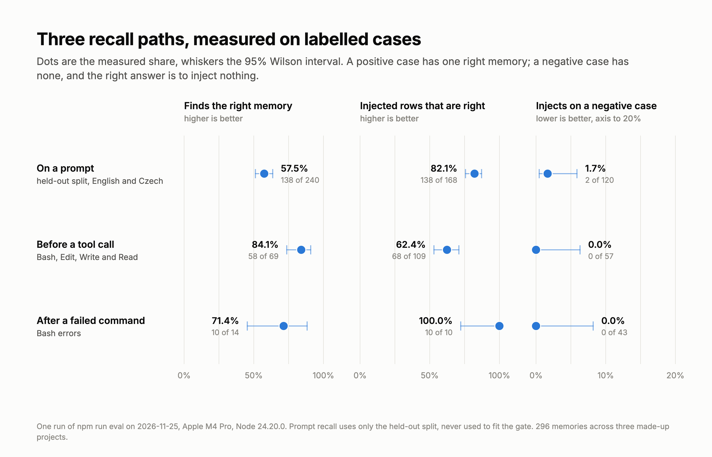
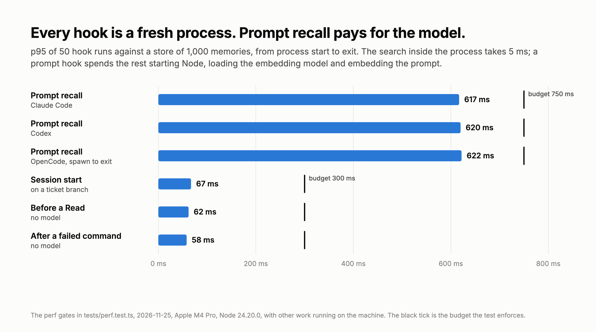

# Evaluation

How well recall works, measured at the host boundary. The numbers on this page come from one run of `npm run eval` and of the performance gates on 2026-11-25, on an Apple M4 Pro with Node 24.20.0. [Rerun them](#rerun-the-evaluation) after any change to recall or the hooks.



## Method

The eval stores a generated corpus of 296 memories across three made-up projects through the real MCP server, each memory with recall questions in English and Czech. It then runs `dist/hooks.js` as a separate process per event, as the host does, against labelled cases:

- A positive case has one right memory. A negative case has none, and the right answer is to inject nothing.
- Prompts: 480 positive and 327 negative, in English and Czech. The calibration split (240 positive, 207 negative) fits the prompt gate with `npm run eval:fit`. The confirmation split (240 positive, 120 negative) is held out and never used for fitting.
- Translated prompts: 100 prompts of the calibration split (60 positive, 40 negative) translated into German, Spanish, Polish and Japanese. The translations are never used for fitting, but their English sources are, so they measure how the gate carries across languages, not unseen questions.

Each table reports three shares, with a 95% Wilson interval where it matters:

| Column | Share of |
|---|---|
| Found | positive cases whose right memory was injected |
| Right lines | injected lines that are a case's right memory, over positive and negative cases together |
| Injects on negative | negative cases that injected any line |

## Prompt recall

| Prompts | Found | Right lines | Injects on negative |
|---|---|---|---|
| Held out, English and Czech | 57.5% (138/240), 51.2 to 63.6 | 82.1% (138/168), 75.7 to 87.2 | 1.7% (2/120), 0.5 to 5.9 |
| Held out, English | 66.7% (80/120), 57.8 to 74.5 | 81.6% (80/98) | 1/60 |
| Held out, Czech | 48.3% (58/120), 39.6 to 57.2 | 82.9% (58/70) | 1/60 |
| Calibration split, fitted on | 79.2% (190/240) | 92.2% (190/206) | 2.9% (6/207) |

The held-out negatives by kind: content-free prompts such as `ok` 0/30, off-topic questions 0/30, vague follow-ups 0/30, questions only another project can answer 2/30.

| Translated prompts | Found | Right lines | Injects on negative |
|---|---|---|---|
| English sources | 91.7% (55/60) | 93.2% (55/59) | 2/40 |
| German | 68.3% (41/60), 55.8 to 78.7 | 93.2% (41/44) | 0/40 |
| Spanish | 73.3% (44/60), 61.0 to 82.9 | 93.6% (44/47) | 1/40 |
| Polish | 58.3% (35/60), 45.7 to 69.9 | 85.4% (35/41) | 1/40 |
| Japanese | 48.3% (29/60), 36.2 to 60.7 | 87.9% (29/33) | 1/40 |

## Tool recall

| Event | Found | Right lines | Injects on negative |
|---|---|---|---|
| Before Bash, Edit, Write and Read | 84.1% (58/69), 73.7 to 90.9 | 62.4% (68/109), 53.0 to 70.9 | 0/57, upper bound 6.3% |
| Of which Read | 81.0% (17/21) | 58.3% (21/36) | 0/39 |
| After a failed Bash command | 71.4% (10/14), 45.4 to 88.3 | 100% (10/10) | 0/43, upper bound 8.2% |

Anchors that are directory prefixes or extensions (`internal/`, `.ts`) also match memories next to the right one, so before a tool call fewer than two thirds of the injected lines are the case's right memory. After a failed command, a memory comes back only through an anchor equal to a term of the error text. The four misses: two exception classes without an `Error` suffix (`LockNotAvailable`, `UniqueViolation`) that never become terms, a server that prints `Address already in use` without the `EADDRINUSE` code, and a lesson with no anchor. Six of the negative failures carry secrets in the error text.

## Supersession, isolation and redaction

| Check | Result |
|---|---|
| A single-valued fact changed: the old value injected | 0/100 |
| A single-valued fact changed: the current value injected on the probe | 74/100 |
| Same key, different values in two projects: the other project's value injected | 0/48 |
| Same key, different values in two projects: the project's own value injected | 40/48 |
| A prompt from a subdirectory finds what it finds from the project root | 290/290 |
| The same prompt twice in one session: the second repeats none of the first's lines | 166/166 |
| A synthetic secret stored with `memory_store` is still in the title, abstract or content read back | 0/17 |

## Latency



The performance gates in `tests/perf.test.ts` spawn each hook about 50 times against a store of 1,000 memories. Every hook is a fresh process: a prompt hook loads the embedding model and embeds the prompt each time, while the search itself takes 5 ms.

| Measure | p95 | Budget |
|---|---|---|
| Prompt recall, Claude Code | 617 ms | 750 ms |
| Prompt recall, Codex | 620 ms | 750 ms |
| Prompt recall, OpenCode, spawn to exit | 622 ms | 750 ms |
| Session start on a ticket branch | 67 ms | 300 ms |
| Before a Read | 62 ms | 300 ms |
| After a failed Bash command | 58 ms | 300 ms |
| Search inside the process | 5 ms | 100 ms |
| One `memory_list` page | 0.43 ms | 20 ms |

A cold first hook run took 632 ms against a 2 s budget. The gates are skipped in CI, where a shared CPU makes the numbers meaningless; see [Performance gates](development.md#performance-gates).

## Real sessions

The [real-session eval](development.md#real-session-eval) runs Claude Code 2.1.331 with a real model. The two baseline cases ran with `--runs 5` and the with-without ablation, the single-arm cases with their default 2 runs.

| Case | Model | Result |
|---|---|---|
| `pretool-procedure` | Haiku | ran `uv run pytest` in 5/5 runs with the plugin, 0/5 without |
| `supersession-current-fact` | Haiku | 0/5 in both arms: its seeded memories carry no recall questions, and the prompt gate does not inject the fact |
| `capture-correction`, `capture-remember`, `capture-resolution`, `store-conflict-supersede`, `neutral-no-checkpoint` | Sonnet | 10/10 runs passed |
| `content-free-silent`, `cross-project-no-leak` | Haiku | 4/4 runs passed |

## Rerun the evaluation

```bash
npm run eval
```

It builds `dist/`, runs every suite, prints the metrics and appends one record per case and per suite to `eval-results/results.jsonl`.

```bash
npm run eval:fit
```

It refits the prompt gate on the calibration split; the weights and the threshold live in `src/calibration.ts`.

```bash
npx vitest run tests/perf.test.ts
```

It runs the performance gates alone and prints every p95 next to its budget. Update this page when the numbers change.
